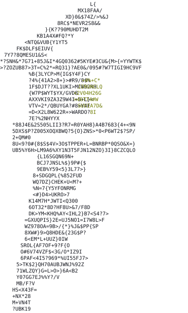

<p align="center">
  
</p>

<h1 align="center">Cosentinel</h1>

<p align="center">
  A local, SSH-based security-posture &amp; hardening orchestrator for the machines you own.
</p>

<p align="center">
  
  
  
</p>

---

## What it is

Cosentinel runs **on your laptop**, connects to the machines **you own** over SSH, and
orchestrates established security scanners in one place — then normalizes, correlates and
keeps a history of everything they find.

It is deliberately **not** two things:

- **Not a scanner.** It does not reinvent Lynis, Nmap or Nuclei — it drives them.
- **Not a hosted service.** There is no always-on daemon and nothing exposed to the
  internet. The entire state is **one folder you control** (a SQLite file, an audit log
  and your config).

> Cosentinel's value is **orchestration, normalization, correlation and history** across
> tools that otherwise live in separate silos.

## What it does

It wraps each scanner in a small adapter and gives you one consistent workflow across all
of them:

| Scanner | What it checks | Runs from | Tier |
|---------|----------------|-----------|------|
| **Lynis** | Host hardening audit | *inside* the machine (SSH) | safe |
| **Nmap** | Network surface / open ports | *outside* | safe |
| **Nuclei** | Known-vulnerability detection | *outside* | safe |
| **testssl.sh** | TLS / certificate posture | *outside* | safe |
| **Nikto** | Web-server misconfigurations & dangerous files | *outside* | safe |
| **OpenVAS / Greenbone** | Deep vulnerability scan via a running GVM | *outside* | safe |
| **ffuf** | Content & endpoint discovery (hidden paths, backups, `.git`/`.env`) | *outside* | **active** |
| **sqlmap** | SQL-injection detection, lab-only proof of impact | *outside* | **active** |
| **OWASP ZAP** | Full active web-application scan (SQLi, XSS, traversal, …) | *outside* | **active** |

Everything becomes a single normalized **finding**, stored in a local SQLite file so you
can diff "today vs last week" and render a static, read-only HTML report.

### Correlation is where it pays off

`cosentinel risks` groups findings by asset (mostly the port) and scores them, so a weak
SSH config (Lynis) on a port that is **also open** (Nmap) and carries a **CVE** (Nuclei)
surfaces as **one high-priority risk** — reachable *and* weak *and* corroborated — instead
of three unrelated lines in three different tools.

## How it works

```
cosentinel scan <target> --profile full
        │
        ▼
  config.load()  ──►  Scope (your allowlist)
        │
        ▼
  Engine.run():
     scope.authorize(target, intensity, confirmed)   # gate + audit
        │
        ├─ adapter runs "inside"   ──►  SSHRunner / LocalRunner (on the target)
        └─ adapter runs "outside"  ──►  LocalRunner, pointed at target.host
        │
        ▼
     adapter.plan()  →  runner.run()  →  adapter.parse()  →  [Finding, …]
        │
        ▼
     Store (SQLite):  scans + findings + history
        │
        ▼
  cosentinel risks / report / diff / history
```

- **Inside vs outside.** Lynis reads the machine's own config from *inside* (over SSH,
  with sudo). Nmap/Nuclei/testssl/Nikto look at it *from outside*, the way an attacker on
  the network would. Cosentinel unifies both views of the same machine.
- **Stable fingerprints.** Each finding's fingerprint excludes timestamps and severity, so
  `diff` between two scans is meaningful.
- **One transport.** Only `transport/ssh.py` ever touches a machine; it shells out to the
  system `ssh` binary with `BatchMode=yes` — Cosentinel never handles your private keys.

See **[ARCHITECTURE.md](ARCHITECTURE.md)** for the full design.

## Why it is safe to run

Three ideas are built into the core, not bolted on:

1. **Scope allowlist.** A machine that is not in your config *cannot* be scanned.
2. **Intensity tiers** — `passive → safe → aggressive → exploit`. The default profiles are
   **detection only** (`safe`). Active profiles (`pentest`, `exploit`) send real payloads
   the way a human tester does, and are gated: aggressive needs an explicit `--confirm`;
   exploit additionally requires the target to be marked `lab: true`. A profile's intensity
   is a *ceiling* — each tool runs only as hard as it is allowed, and the heavy tools
   (sqlmap / ZAP / ffuf) never fire in a `safe` scan at all.
3. **Audit log.** Every authorized (or refused) action is appended to
   `.cosentinel/audit.jsonl`, and `--dry-run` prints the exact commands before anything runs.

> **Use it only on systems you own or are explicitly authorized to test.** The allowlist is
> the control, and every action is written to the audit log.

## Install

```bash
python3 -m venv .venv && . .venv/bin/activate
pip install -e .
```

Then install the scanners you want. Adapters skip gracefully when a tool is missing —
`cosentinel adapters` shows what's available on this host.

```bash
brew install nmap nuclei          # macOS (plus testssl, nikto, ffuf, sqlmap as needed)
# Lynis runs on the *target*; install it there (e.g. apt install lynis).
```

## Quick start

```bash
cosentinel init                       # create cosentinel.yaml (your allowlist) + .cosentinel/
cosentinel targets                    # show the allowlist
cosentinel adapters                   # which scanners are available on this host
cosentinel scan localhost --dry-run   # see the EXACT commands, run nothing
cosentinel scan localhost             # run the 'full' profile (SAFE, detection only)
cosentinel risks localhost            # correlated, prioritized risks (not raw findings)
cosentinel report localhost -o report.html   # static HTML report
cosentinel diff localhost             # what changed since the previous scan
cosentinel history                    # past scans
```

## Configuring targets

Your `cosentinel.yaml` **is** the allowlist. A target can be the local box, a remote host
over SSH, or a website — each reached differently:

```yaml
settings:
  db: .cosentinel/cosentinel.db
  audit_log: .cosentinel/audit.jsonl

targets:
  # The machine you're on (no SSH). Good for a first run.
  - id: localhost
    host: 127.0.0.1
    ssh: false
    sudo: true          # Lynis wants root to read system config
    lab: true           # a box you own outright

  # A remote host over SSH. `host` matches ~/.ssh/config, or is an IP/hostname;
  # your keys and agent are reused automatically.
  - id: homeserver
    host: homeserver
    ssh: true           # enables Lynis from inside
    sudo: true
    url: http://homeserver    # optional, for web/vuln scanners
    tags: [prod]

  # A website / web address you own. ssh:false + a non-local host => "web-only":
  # only the outside-in scanners run (nmap, nuclei, testssl, nikto); Lynis is skipped.
  - id: mysite
    host: example.com
    ssh: false
    url: https://example.com
    tags: [web]
```

## Profiles

| Profile   | Intensity   | Scanners | What it does |
|-----------|-------------|----------|--------------|
| `audit`   | safe        | lynis | Hardening audit from inside |
| `network` | safe        | nmap | Network surface from outside |
| `vuln`    | safe        | nuclei | Known-vulnerability detection |
| `tls`     | safe        | testssl | TLS / certificate posture |
| `web`     | safe        | nikto | Web-server misconfigurations |
| `full`    | safe        | lynis + nmap + nuclei + testssl + nikto | Everything available (default) |
| `openvas` | safe        | openvas | Deep GVM scan (needs a running Greenbone) |
| `pentest` | aggressive  | full + ffuf + sqlmap + zap | Active testing like a human attacker. **Needs `--confirm`.** |
| `exploit` | exploit     | nmap + nuclei + testssl + nikto + sqlmap + zap | Prove impact, not just presence. **Needs `--confirm` + `lab: true`.** |

```bash
cosentinel scan e0 -p pentest --confirm              # active test of a host you own
cosentinel scan e0 -p pentest --confirm --dry-run    # see exactly what WOULD run, first
```

## Commands

| Command | Purpose |
|---------|---------|
| `cosentinel init [--dir DIR]` | Create a starter `cosentinel.yaml` + `.cosentinel/` |
| `cosentinel targets` | List the allowlist (id, host, access, sudo, lab, tags) |
| `cosentinel adapters` | List scanners and whether each tool is present on this host |
| `cosentinel profiles` | List the scan profiles |
| `cosentinel scan <target…> [--all] [-p PROFILE] [--confirm] [--dry-run]` | Run a scan |
| `cosentinel risks <target>` | Correlated, prioritized, scored risks |
| `cosentinel report <target> [-o FILE]` | Write a static HTML report |
| `cosentinel diff <target>` | What changed since the previous scan |
| `cosentinel history [target]` | Past scans |

Global: `-c/--config PATH` to point at a specific config, `--version`.

## Active testing notes

**ffuf wordlist.** Point `COSENTINEL_WORDLIST` at a wordlist, or install one (SecLists /
dirb); a small starter list ships in `wordlists/common-web.txt`.

**Running ZAP natively (for Tailscale / host-only targets).** ZAP's packaged
`zap-full-scan.py` ships only in its Docker image, and a container can't reach a Tailscale
IP. To scan such a target, install ZAP natively and point the adapter at the bundled shim,
which drives `zap.sh` in quick-scan mode:

```bash
# one-time: install a JDK 17+ and ZAP (fetch ZAP's Cross-Platform package from the
# official release, since the Homebrew cask is currently disabled), then:
export COSENTINEL_ZAP="$PWD/scripts/zap-native.sh"   # or symlink it onto your PATH
cosentinel scan e0 -p pentest --confirm
```

The shim finds `openjdk` and `zap.sh` automatically (override with `JAVA_HOME` / `ZAP_SH`).
`COSENTINEL_ZAP` also accepts a full command (e.g. a `docker … zap-full-scan.py`
invocation), exactly like `GVM_CLI` does for OpenVAS.

## Reports

`cosentinel report <target>` writes a single self-contained HTML file: severity counts,
the prioritized risks, and every finding with its remediation. It **executes nothing and
talks to nothing** — it's just a read-only view of a scan you can open in a browser or hand
to someone else.

## Status

**Detection** (Lynis, Nmap, Nuclei, testssl.sh, Nikto, OpenVAS) **plus gated active
testing** (nuclei DAST, ffuf, sqlmap, OWASP ZAP) behind the `pentest` / `exploit` tiers.
Exploitation is limited to *proving impact* (e.g. sqlmap reaching the DBMS) and only on
`lab` targets; it never dumps table data. Roadmap and internals are in
[ARCHITECTURE.md](ARCHITECTURE.md).

## Tests

```bash
pip install -e ".[dev]" && pytest -q
```

## License

MIT.
